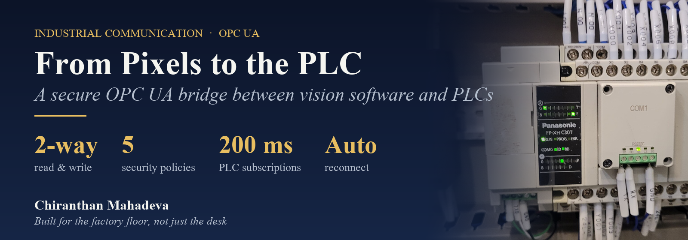
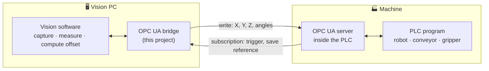
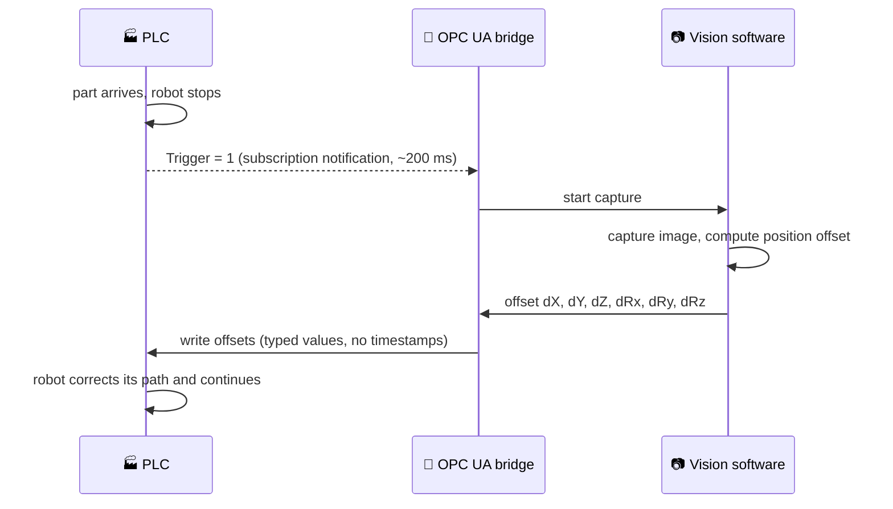
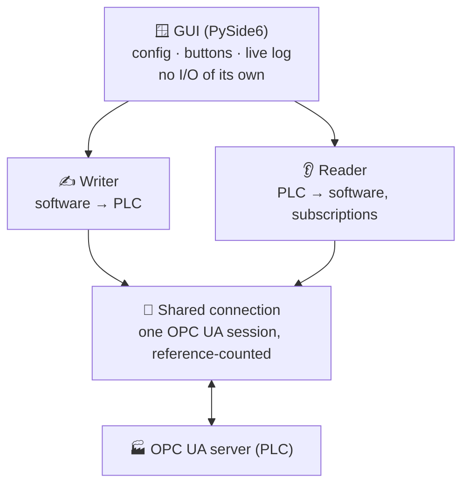

  

  
  
  
  

  <b>A desktop application that connects machine-vision software directly to a PLC: 
  it writes measurement results into the machine and reacts instantly when the machine asks for a new image.</b>

> **Source code is private.** It was built for industrial customer projects. This page explains *what* was built, *how* such a pipeline works and what I learned. No client names are used.

---

## 🤔 New to this? The 60-second version

**What is a PLC?**
A *programmable logic controller* is the small industrial computer that runs a machine: it moves the robot, starts the conveyor, opens the gripper. It's built to run 24/7 and is programmed by automation engineers, not by vision developers.

**What is the problem?**
The vision software runs on a normal PC. It finds a part, measures it and calculates an offset, but **the PLC has to receive that number** to act on it. And the PLC has to be able to **tell the vision software** "the part is in position, take a picture now".

**What is OPC UA?**
*OPC UA* (Open Platform Communications Unified Architecture) is the **common language of industrial machines**. Almost every modern PLC (Siemens, B&R, Beckhoff, …) has an OPC UA server built in. You can picture it like this:

| Everyday picture | OPC UA term |
|---|---|
| A shared **notice board** inside the machine | the **OPC UA server** on the PLC |
| Each note on the board, with a fixed address | a **variable** (node) with a **NodeId**, e.g. `ns=3;i=1008` |
| Writing a new value on a note | a **write** |
| Asking "tell me when this note changes" | a **subscription** |
| A locked board that only trusted visitors can use | **security**: certificates, signing, encryption |

**What did I build?**
A bridge application that sits on the vision PC, talks OPC UA to the PLC, and connects both worlds **in both directions**, securely and without a person in between.

---

## 🏭 The pipeline end to end

### One production cycle

The same pipeline works in **PLC-driven mode** (the machine triggers every capture, and the operator buttons are locked) or in **manual mode** for commissioning.

## 🧩 What the application does

| Area | Features |
|---|---|
| **Connection** | Connect / test, **endpoint discovery** (lists what the server offers), **node browser** to find variables without a manual |
| **Security** | **5 security policies** (Basic128Rsa15, Basic256, Basic256Sha256, Aes128Sha256RsaOaep, Aes256Sha256RsaPss) plus unsecured for testing · modes *None / Sign / SignAndEncrypt* · anonymous or username/password · **one-click self-signed client certificate** · optional server certificate |
| **Write (software → PLC)** | Variable table: name, data type (Bool, Int16/32/64, UInt16/32/64, Float, Double, String), NodeId, optional namespace URI, which vision value it carries, optional **sign flip** for axes that point the other way on the machine |
| **Read (PLC → software)** | Variable table with **subscriptions**. A PLC value can trigger an **action** in the vision software, such as *Trigger capture* or *Save reference* |
| **Reliability** | Auto-reconnect for both directions · one shared connection · typed value conversion · clear live log |
| **Integration** | Runs **inside** the vision application (results pushed directly) or **standalone** as a file ↔ PLC bridge for third-party vision runtimes |
| **Operations** | Load/save configuration (JSON), log viewer, starts without a console window |

## 🔧 How it is built

- **Thin GUI, independent workers**: the window only edits settings and starts or stops the workers. The reader and writer run on their own threads and could run headless as a service.
- **One shared, reference-counted connection** for both directions: fewer sessions on the PLC (some servers limit or license them) and no two clients drifting apart during reconnects.
- **Subscriptions for reading, not polling**: the PLC *pushes* a notification when a value changes. That means almost no CPU and sub-second reaction time.
- **Polling with a stability check for files** (standalone mode): a file is only read once its size and timestamp stop changing, so half-written files are never sent.

## ⚠️ What the factory floor taught me

These problems aren't in most tutorials, but they decide whether an integration works:

1. **"BadWriteNotSupported" on a perfectly valid write.** Many client libraries silently attach a timestamp to every write, and some PLC servers (seen with B&R and certain Siemens configurations) **reject client timestamps**. Fix: build the value by hand and **send only the value, without timestamps**.
2. **Namespace indexes move.** `ns=3` is only a position in the server's namespace list, and it can change when the PLC project is recompiled. Storing the **namespace URI** and resolving the index at connect time makes the configuration survive PLC updates.
3. **Windows file locking.** When another program briefly holds the output file, an atomic replace can fail. A short retry burst with exponential back-off (50 → 400 ms) clears it without delaying the next update.
4. **Security is a two-sided handshake.** The client can generate certificates and encrypt, but the **PLC administrator must still trust the certificate** and grant read/write rights. Plan that conversation early.
5. **The protocol is the easy part.** Most of the work is in the edges: reconnects, data types, vendor quirks, file locks.

## ✅ Status

- Used in production vision software: robot guidance (writing 6-axis pose offsets) and a vision-runtime file bridge.
- Verified against an industrial OPC UA simulation server and at a customer site.
- Supports secure (signed and encrypted) and anonymous connections.

## 🧰 Tech stack

**Python 3** · **OPC UA** (FreeOpcUa python-opcua client) · **PySide6 / Qt** desktop GUI · **cryptography** (X.509 certificate generation) · JSON configuration · threads + OPC UA subscriptions

## 🔗 Related

- **[RESTAPI-VisionGateway](https://github.com/Gojoinferno/RESTAPI-VisionGateway)**: the other half of plant integration. A REST interface that lets the plant's control system trigger measurements and fetch results.
- **[OPC Foundation: What is OPC UA?](https://opcfoundation.org/about/opc-technologies/opc-ua/)**: official introduction to the standard.

---

  <b>Chiranthan Mahadeva</b> · Industrial machine vision & automation 
  More: <a href="https://github.com/Gojoinferno/Realtime-DigitOCR">Realtime-DigitOCR</a> ·
  <a href="https://github.com/Gojoinferno/MachineVision-Research">MachineVision-Research</a>

Banner photo: "PLC Panasonic FP-XH C30T" by Angga Panca Alam Anugrah, <a href="https://commons.wikimedia.org/wiki/File:PLC_Panasonic_FP-XH_C30T.jpg">Wikimedia Commons</a>, CC BY-SA 4.0 (cropped). The banner is shared under the same license.
